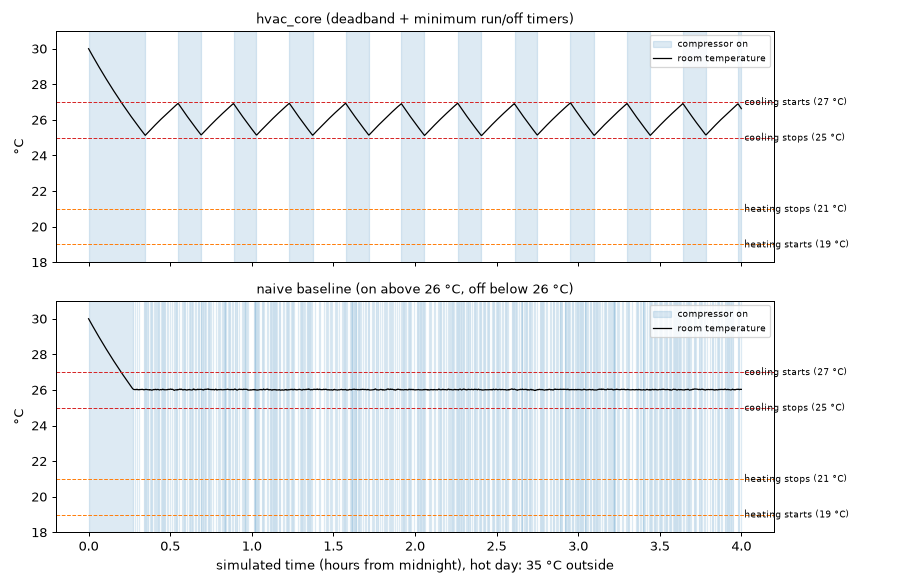

# hvac-linux-driver

[](https://github.com/Prince4552/hvac-linux-driver/actions/workflows/ci.yml)

A Linux kernel driver for an I2C temperature sensor, a hardware-free test suite that proves it correct
and memory safe, and an HVAC thermostat daemon that speaks Modbus TCP. It is built with Buildroot and
tested on an emulated ARM64 board in QEMU.

## What this is and why it matters

HVAC (heating, ventilation and air conditioning) controllers are small embedded Linux computers. A
sensor chip on a two-wire I2C (Inter-Integrated Circuit) bus reports the room temperature. A kernel
driver turns the chip's register bits into a number, and a control program decides when to run the
compressor or heater. A building management system watches it all over an industrial protocol such as
Modbus. This repository builds each of those layers, small but complete. It tests them automatically
without any hardware: the chip is simulated inside the Linux kernel (`i2c-stub`) on an emulated ARM
board. It also measures what matters, including memory safety, protection against compressor
short-cycling, and fault-detection time.

## Architecture

```
 host PC (or GitHub Actions)
   make test-host : unit tests (+ sanitizers, Valgrind, coverage), room simulation, daemon tests
   make test-qemu : Buildroot ARM64 image -> boot in QEMU -> run all tests inside -> collect results
 +----------------------------------------------------------------------------+
 | QEMU ARM64 board                                                           |
 |  user space   hvacd: sensor_iio -> hvac_core -> Modbus TCP (port 502)      |
 |               ^ reads /sys/bus/iio/devices/iio:deviceN/in_temp_{raw,scale}  |
 |  kernel       IIO core -> hvac_temp.ko (our driver) -> I2C core            |
 |               -> i2c-stub (simulated TMP102-style chip at address 0x48)    |
 +----------------------------------------------------------------------------+
```

## Quick start

Requirements: Ubuntu (WSL2 is fine), at least 25 GB free disk, 8 GB RAM recommended.

```
git clone https://github.com/Prince4552/hvac-linux-driver.git && cd hvac-linux-driver
make check-env     # checks tools; prints the exact "sudo apt install ..." line for anything missing
make test-host     # about 2 minutes: unit tests, sanitizers, Valgrind, coverage, simulation
make test-qemu     # first time 30-90 minutes (builds Linux); later about 6 minutes
make run           # boots the board in demo mode; log in as root; quit with Ctrl-A then X
```

While `make run` is running, read the thermostat over Modbus from the host (port 502 in the board is
forwarded to 5020):

```
python3 tests/common/modbus_client.py --port 5020 read 0 10     # 0: 2500 = 25.00 C, 1: 0 = IDLE, ...
python3 tests/common/modbus_client.py --port 5020 write 2 2350  # cooling setpoint 23.50 C
```

`make mutation` (about 20 minutes) proves the tests catch deliberately inserted driver bugs. It is not
run in CI because it rebuilds the image three times.

## Results

Key numbers from `make test-all`, `make mutation` and `make metrics`. All metrics, with meanings, are in
[results/METRICS.md](results/METRICS.md).

| What | Result | Target |
| --- | --- | --- |
| In-guest tests (driver, platform, daemon end to end) | 98 passed, 0 failed, 0 skipped | 0 failed |
| Host tests (unit x3 builds, integration, simulation) | 76 passed, 0 failed | 0 failed |
| Kernel memory errors (KASAN), leaks (kmemleak), lock bugs (lockdep) | 0 / 0 / 0 | 0 |
| Driver load/unload cycles without a problem | 500 | >= 500 |
| Wrong reads with 8 threads reading at once (8000 reads) | 0 | 0 |
| Mutation score (deliberate driver bugs caught by the tests) | 3/3 | 3/3 |
| checkpatch / sparse / cppcheck findings | 0 / 0 / 0 | 0 |
| Control-core coverage (lines / branches) | 100 % / 98.9 % | >= 95 / >= 90 |
| User-space sanitizer and Valgrind errors, leaked bytes | 0 / 0 / 0 | 0 |
| Simulated comfort, all three 24 h scenarios | 100 % | >= 98 % |
| Compressor starts per hour, hot day: hvac_core vs naive thermostat | 2.83 vs 592 | fewer |
| Sensor loss -> alarm visible over Modbus | 0.12 s | <= 1.6 s |



*Top: `hvac_core` lets the room swing between 25 and 27 °C with a short cooling run every ~20 minutes.
Bottom: a naive thermostat holds 26 °C but switches the compressor on and off every few seconds, which
wears it out.*

## Extensions

| Extension | What it adds | Key result |
| --- | --- | --- |
| Ext 1: watchdog | `hvacd` kicks `/dev/watchdog` after each control step; magic close on shutdown | frozen daemon detected in 1.94 s (timeout 2 s) |
| Ext 2: fault detection | Two rules (cooling ineffective, sensor stuck) published in Modbus register 8 | 5/5 injected faults detected (26.4 min average), 0 false alarms in 15 healthy simulated days |
| Ext 3: MQTT telemetry | JSON telemetry every `mqtt_period_s`, retained online/offline status with last will, never blocks control | loop period changed by 4 ms with the broker down; reconnect in 4.78 s; 100 % of messages received |

## Repository map

| Folder | Contents |
| --- | --- |
| `driver/` | The `hvac_temp` kernel module (GPL-2.0-only) and its KUnit tests |
| `examples/hello_module/` | A minimal kernel module for learning |
| `thermostat/` | Control core, configuration parser, `hvacd` daemon, simulator, Unity unit tests |
| `br2-external/` | Buildroot customization: defconfig, kernel config fragment, init scripts, packages |
| `tests/` | Guest tests (run inside QEMU), host tests, shared Modbus client, mutation patches |
| `scripts/` | Every build, test and report step (the Makefile only calls these) |
| `results/` | Committed metrics summary; generated logs (not committed) |
| `docs/` | Plan, rules, decisions, progress, learning notes, technical report |

## Documentation

- [Technical report](docs/TECHNICAL_REPORT.md): the whole project explained for a non-specialist.
- Learning notes per phase: [0 foundation](docs/phases/phase-00-foundation.md),
  [1 platform](docs/phases/phase-01-platform.md), [2 driver skeleton](docs/phases/phase-02-driver-skeleton.md),
  [3 complete driver](docs/phases/phase-03-complete-driver.md),
  [4 hardening](docs/phases/phase-04-driver-hardening.md), [5 control core](docs/phases/phase-05-control-core.md),
  [6 daemon](docs/phases/phase-06-daemon.md), [7 CI and publishing](docs/phases/phase-07-ci-publishing.md).
- [Decisions](docs/DECISIONS.md) (every choice the plan left open), [plan](docs/PROJECT_PLAN.md),
  [engineering rules](docs/ENGINEERING_RULES.md), [progress](docs/PROGRESS.md).

## Limitations

- No real hardware: the chip is `i2c-stub` (memory inside the kernel), so electrical problems and real
  sensor noise are out of scope. `i2c-stub` also cannot fail a transfer after probe (see D-018).
- QEMU emulates the ARM CPU in software, so all timings are relative, not what a real board would show.
- Outputs (compressor, heater, fan) are logged, not wired to GPIO pins.
- Fault detection is rule-based and the building is a one-room model.

## License

`driver/` is GPL-2.0-only (required for a kernel module that uses IIO). Everything else is MIT. See
[LICENSE](LICENSE) and [THIRD_PARTY.md](THIRD_PARTY.md).
