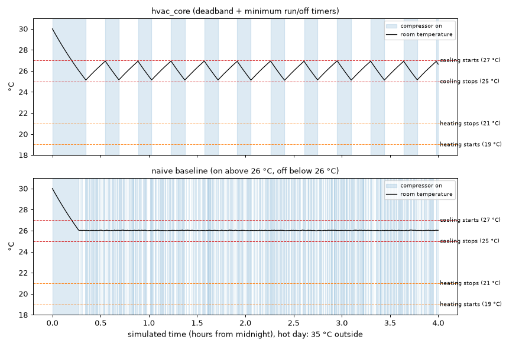

# Technical report: an HVAC temperature-sensor driver, its tests, and a thermostat daemon

## 1. Summary

This project builds the software chain inside a small heating and cooling controller. It starts at the
temperature-sensor chip and ends at a network interface that a building management system can read.
It has three main parts:
- A Linux kernel driver for a TMP102-style I2C temperature sensor.
- A thermostat program (`hvacd`) whose decision logic is a pure, separately tested state machine.
- A Modbus TCP interface to the outside world.

Everything runs on an emulated ARM64 board built from source with Buildroot, and the sensor chip is
simulated inside the kernel, so no hardware is needed. The automated test suite runs 98 tests inside
the emulated board and 76 checks on the host. The headline results:
- Zero memory errors, leaks and locking problems found by the kernel's own checkers over hundreds of
  load/unload cycles.
- All three deliberately inserted driver bugs caught by the tests.
- 100 % line and 98.9 % branch coverage of the control logic.
- In a 24-hour simulated hot day, the compressor starts 2.83 times per hour, against 592 times per hour
  for a naive thermostat, with the room comfortable 100 % of the time.

## 2. The problem in everyday terms

A thermostat does three things. It measures the room temperature, decides whether to cool, heat or do
nothing, and switches the equipment. In a commercial building it also reports to a central computer,
the building management system (BMS), which can change its setpoints.

The temperature comes from a small chip. The chip does not send "24.5 °C". It holds a 16-bit number in
a *register* (a tiny storage box inside the chip), coded in a format given in its data sheet. Software
must ask the chip for that number over a two-wire bus called I2C (Inter-Integrated Circuit), decode it,
and pass it on. If the decoding is wrong, every decision built on it is wrong. If the software
crashes, leaks memory or deadlocks, the building gets too hot or too cold, or the compressor (the most
expensive part of an air conditioner) is damaged.

So the software between the chip and the equipment must be correct, must keep running for years, and
must fail safely. This project builds that software and, just as importantly, the evidence that it
behaves.

## 3. The system at a glance

```
 HOST PC (development machine, or GitHub Actions)
   builds everything, starts the emulated board, collects the results
 +-------------------------------------------------------------------------+
 | Emulated ARM64 board (QEMU)                                              |
 |  USER SPACE   hvacd  = sensor reader -> control core -> Modbus server   |
 |  ---------------------------- system calls -----------------------------|
 |  KERNEL       IIO framework -> hvac_temp driver -> I2C core -> i2c-stub |
 +-------------------------------------------------------------------------+
```

**One reading, start to finish:**

1. Once per second, `hvacd` reads two small text files the kernel provides:
   `/sys/bus/iio/devices/iio:device0/in_temp_raw` and `in_temp_scale`.
2. Reading `in_temp_raw` makes the kernel call our driver's `read_raw()` function.
3. The driver takes its lock, asks the I2C core for register 0x00 of the chip at address 0x48, and
   releases the lock.
4. `i2c-stub`, a kernel module that imitates a chip in memory, answers with the stored 16-bit value. A
   real chip would answer over two wires.
5. The driver turns 0x1900 into the signed number 400, and the kernel turns that into the text "400".
6. `hvacd` multiplies 400 by the scale 62.5 to get 25,000 millidegrees (25.000 °C). It gives this to the
   control core, applies the decision, and updates ten Modbus registers that a BMS can read over the
   network.

## 4. Components explained simply

### 4.1 The driver (`driver/`)

A *driver* is code inside the operating-system kernel that knows how to talk to one kind of device.
Programs cannot touch hardware directly; they ask the kernel, and the kernel asks the driver.

**What it does.** When a device named `hvac_temp` appears on an I2C bus, the kernel calls the driver's
`probe()` function. Probe checks that the bus can do the transfers we need, and reads one register to
make sure a chip is really there. It then registers with IIO (Industrial I/O), Linux's standard
framework for sensors. IIO creates the files user programs read. The driver adds two read-write files
for alarm limits, in millidegrees.

**The ideas that make it work.**
- *Decoding.* The chip sends the most significant byte first, the opposite of the bus's default, so
  the driver swaps the bytes. The temperature sits in the top 12 bits as a *two's complement* number
  (the usual way computers store negative numbers). The driver shifts away the 4 unused bits and copies
  the sign bit upwards. One step is 1/16 °C. These four conversions live in one small header
  (`hvac_temp_conv.h`) that the driver and its kernel tests share, so the tests check the exact code
  that runs.
- *Automatic cleanup.* Every resource is allocated with a `devm_` ("device-managed") function. When
  the device disappears, the kernel frees everything in the right order, so the driver needs no
  cleanup function and cannot get cleanup wrong.
- *One lock per device.* A mutex (mutual-exclusion lock) makes sure one I2C conversation finishes before
  the next starts. It is a mutex and not a spinlock because I2C transfers may sleep.
- *Distrust of input.* A value written to an alarm file is parsed, range-checked (-40 °C to 125 °C)
  and rejected with "invalid argument" if anything is wrong. Only then does it reach the chip.

*Analogy:* the driver is a translator who speaks the chip's private dialect and repeats everything in
the standard language all programs understand.

### 4.2 The simulated chip and the driver tests (`tests/guest/`)

`i2c-stub` ships with Linux. It pretends to be a chip at any address you choose and keeps 256
registers in memory. Tests write a register with the standard `i2cset` tool, then read the driver's
files and check the answer. This lets them create situations that are hard in a lab, such as exactly
-40 °C, a missing chip, or a device removed while a program is reading it.

The tests run *inside* the emulated board, under pytest. A small runner prints the results between
fixed marker lines on the board's serial console, and the host cuts them out. After every single test,
the kernel log written during that test is searched for signs of trouble (`BUG:`, `WARNING:`, `Oops`,
`KASAN`, ...). A test that "passes" while the kernel complains is still a failure.

### 4.3 The thermostat core (`thermostat/src/hvac_core.c`)

**What it does.** It decides between four states: IDLE, COOLING, HEATING and FAULT. Cooling starts at
27 °C and stops at 25 °C. Heating starts at 19 °C and stops at 21 °C. The compressor must run at least
2 minutes and rest at least 3 minutes before restarting. A reading counts as bad if it is missing,
outside -40..125 °C, or jumps more than 5 °C since the last good one. A bad reading switches everything
off and raises the alarm, and five good readings in a row end the fault.

**The ideas that make it work.**
- *Hysteresis (a deadband).* Different thresholds for on and off. Without them, a temperature hovering
  around one threshold would switch the compressor every second.
- *Short-cycle protection.* The minimum run and rest times protect the compressor from damage.
- *Purity.* The core gets the temperature *and the current time* as arguments. It never reads a clock
  or a file and never allocates memory. Tests can therefore jump to "179,999 milliseconds later" and
  check that the compressor is still resting, without waiting. The same code runs unchanged in the
  daemon, the simulator and (in an extension) on a microcontroller operating system.

*Analogy:* the core is a rule book. It does not look at the clock on the wall; whoever consults it must
say what time it is.

### 4.4 The daemon and Modbus (`thermostat/src/`)

**What it does.** `hvacd` is a background program ("daemon"). It reads its settings from
`/etc/hvacd.conf`. Every loop period it reads the sensor, runs the core, logs any change of state or
outputs, and refreshes its Modbus register table. Between those ticks it answers network requests.

**The ideas that make it work.**
- *One thread, one `select()` loop.* `select()` waits until a network client sends something or the
  next tick is due, whichever comes first. With a single thread there are no data races, and the code
  reads from top to bottom.
- *Modbus TCP.* A simple industrial protocol. A client asks "give me 10 registers starting at 0" and gets
  ten 16-bit numbers back: temperature in hundredths of a degree, state, setpoints, outputs, alarms,
  compressor starts, uptime, diagnostics and protocol version.
- *Validated remote writes.* A BMS may write new setpoints. The daemon checks them on its next tick with
  the same rules as the configuration file. Valid values are applied. Invalid values are replaced by
  the previous ones and an alarm bit is set.
- *Fixed memory.* Memory is allocated only at start-up, and every text buffer has a fixed size, so the
  program's memory use cannot grow over months of running.

### 4.5 The build platform (`br2-external/`, `scripts/`)

**Buildroot** builds a complete Linux system from source:
- A cross-compiler (an x86 program that produces ARM code).
- The Linux kernel 6.18.7 with our configuration (I2C, IIO, the simulated chip, and the memory checkers).
- A small root filesystem with a shell, Python, pytest and our programs.

Every download is pinned to an exact version and checked against a known checksum, so a build today and
a build next year use identical inputs. Buildroot does the same job as Yocto, the tool often used in
industry, but is simpler to learn.

**QEMU** emulates the ARM64 board in software. One command builds the image, and one command boots it in
"autotest" mode. In that mode the board runs every test, prints the results, and powers itself off. A
hard timeout and the `panic=5` setting guarantee the run always ends, even if the kernel crashes.

## 5. How we know it works

| Layer | Runs on | What it proves | What it would catch |
| --- | --- | --- | --- |
| Static analysis (checkpatch, sparse, cppcheck, shellcheck, pyflakes) | host | Code follows the rules and has no common bug patterns | Style errors, wrong-endian values, unchecked results, shell quoting bugs |
| Platform smoke tests | board | The board has every tool and kernel option the other tests need | A kernel option silently dropped (this happened, see section 10) |
| Kernel unit tests (KUnit) | board | Conversion math is exact for all 4096 possible values | Off-by-one rounding, missing sign extension |
| Driver functional tests | board | Readings, scale, alarm limits, bad input, missing chip | Wrong byte order, wrong rounding, accepting bad input |
| Robustness and memory tests | board | No leaks, invalid accesses or lock problems under stress | Leaks, use-after-free, races, deadlocks |
| Mutation testing | board | The tests notice real bugs | A test suite that passes no matter what |
| Core unit tests (x3: normal, sanitizers, Valgrind) | host | Every rule, boundary and timer of the state machine | Off-by-one thresholds, timer mistakes, memory errors |
| Simulation (software in the loop) | host | Control quality over 24 simulated hours | Short-cycling, poor comfort |
| Daemon integration tests | host | Daemon, Modbus and fake sensor files together, also under Valgrind | Protocol mistakes, leaks, wrong exit codes |
| End-to-end tests | board | Real driver, daemon and network together | Anything lost between layers |
| Continuous integration | GitHub | A fresh checkout builds and passes | "Works on my machine" problems |

## 6. Results

The full table is generated by `make metrics` into `results/METRICS.md`. The most important rows:

| Metric | Value | Target | What it means |
| --- | --- | --- | --- |
| In-guest tests | 98 passed, 0 failed | 0 failed | Tests run on the emulated board |
| Host tests | 76 passed, 0 failed | 0 failed | Unit, integration and simulation checks |
| KUnit cases | 5 of 5 | all | Kernel-level checks of the conversion math |
| Driver load/unload cycles | 500 | >= 500 | Times the driver was loaded, used and removed without a problem |
| kmemleak / KASAN / lockdep reports | 0 / 0 / 0 | 0 | Leaks, invalid memory accesses, possible deadlocks |
| Concurrent read errors | 0 | 0 | Wrong or failed readings with 8 threads x 1000 reads |
| checkpatch / sparse / cppcheck findings | 0 / 0 / 0 | 0 | Problems found by reading the code |
| Mutation score | 3/3 | 3/3 | Deliberate driver bugs the tests caught |
| Core coverage (lines / branches) | 100 % / 98.9 % | >= 95 / >= 90 | Share of the control logic exercised by tests |
| Sanitizer / Valgrind errors, leaked bytes | 0 / 0 / 0 | 0 | Memory errors in user-space code |
| Comfort, all scenarios | 100 % | >= 98 % | Time the simulated room stayed within 18.5..27.5 °C |
| Compressor starts per hour, hot day | 2.83 (naive: 592.2) | fewer than naive | How gently the compressor is used |
| Short-cycle violations | 0 | 0 | Compressor restarts less than 3 minutes after stopping |
| Fault detection latency | 0.12 s | <= 1.6 s | Sensor removed -> alarm visible over Modbus |
| Driver read latency (median) | about 1.2 ms | report | One reading on the emulated board, with Python overhead |
| Modbus round trip (median) | about 2 ms | report | One request and reply on the emulated board |
| Daemon memory / size | 1.4 MB / 26 KB | report | Resident memory after 30 s / program file size |



**Interpretation of the simulation.** On a 35 °C day the room starts at 30 °C. Both controllers reach
the comfort band within 10 minutes and keep the room comfortable all day. The difference is how they get
there. The naive thermostat holds exactly 26 °C by switching the compressor on and off 14,213 times in a
day, almost always only seconds apart. The product core lets the room drift between 25 and 27 °C and
starts the compressor 68 times, each time after a rest of at least 418 seconds. Both use the compressor
about 52 % of the time, so the gentler behaviour costs no energy. It simply avoids the wear.

## 7. Safety and memory handling

Rules followed (`docs/ENGINEERING_RULES.md`):
- **Kernel:** device-managed allocation only, no global state, every return value checked, every user
  input parsed and range-checked, output only through the bounds-safe `sysfs_emit()`, no floating point,
  one mutex per device, never a spinlock around I2C.
- **User space:** C11 compiled with strict warnings as errors, including all sign and size conversions.
  Fixed-size buffers and checked `snprintf()`. Banned unsafe functions (`strcpy`, `sprintf`, `atoi`, ...).
  Allocation only at start-up. Signal handlers that only set a flag. A single thread.

Evidence:
- **KASAN** (Kernel Address Sanitizer) checks every kernel memory access. **kmemleak** finds memory no
  one points to any more. **lockdep** checks the order in which locks are taken. All three were enabled
  for every test, through 500 load/unload cycles, 8 threads reading at once, readers racing writers, and
  a device deleted under an active reader. They reported nothing.
- **AddressSanitizer, UndefinedBehaviorSanitizer and Valgrind** ran every user-space unit test, the
  simulator and a full daemon scenario. They found 0 errors and 0 leaked bytes.
- **Mutation testing:** three patches break the driver on purpose (no sign extension, no byte swap, no
  range check). The full suite failed on each: 11, 29 and 4 failing tests respectively (the daemon end-to-end tests also catch the byte-swap mutant). This shows the
  tests protect against exactly the mistakes a driver author is most likely to make.
- The static checkers were each shown to work on a deliberately broken file first. A silent checker that
  checks nothing would look exactly like a clean result.

## 8. Extensions

### 8.1 Watchdog supervision (Ext 1)

A watchdog timer resets the board unless the software regularly proves it is alive. `hvacd` arms
`/dev/watchdog` at start-up. It "kicks" it after every completed control step, never from a separate
timer, so a hung loop really does stop the kicks. On a clean shutdown it writes the "magic close"
character `V`, which tells the kernel the stop is intentional. The tests use the kernel's software
watchdog in a mode that only logs instead of rebooting. A healthy daemon never triggers it. A daemon
frozen with `SIGSTOP` triggers it after **1.94 s** (timeout 2 s). A clean shutdown leaves it quiet.

### 8.2 Fault detection and diagnostics (Ext 2)

FDD (fault detection and diagnostics) means spotting equipment problems from operating data before a
person notices them. `hvac_fdd.c` adds two rules. Like the control core, it is pure: no memory
allocation, no input/output, no clock.

| Bit | Rule | Default | Typical cause |
| --- | --- | --- | --- |
| 0 `COOLING_INEFFECTIVE` | Compressor on for a whole window, room cooled by less than the minimum | 1200 s window, 0.5 °C | Low refrigerant, dead compressor |
| 1 `SENSOR_STUCK` | Valid reading unchanged, even by 1/16 °C | 1800 s | Frozen sensor or wiring |

The bits latch until `hvacd` restarts. They appear in Modbus register 8, and each is logged once.
The simulator injects each fault at 06:00 into a 24-hour day run with the real core:

| Experiment | Result |
| --- | --- |
| Detection matrix (5 cases) | 5/5 detected; capacity loss and compressor failure after 21.1 min, stuck sensor after 29.9 min (mean 26.4 min) |
| False-alarm matrix (3 healthy days x 5 seeds) | 0 false alarms |

A fault can only be detected when the affected part is used. A broken compressor on a cold day, with
no cooling demand, stays hidden: the compressor never runs, so the rule has nothing to judge. That is
why the cooling faults appear only in the hot-day matrix. The thresholds fit this simulated room; a
real building would need field data to tune them (see D-028).

### 8.3 MQTT telemetry (Ext 3)

MQTT (Message Queuing Telemetry Transport) is the usual protocol for sending equipment data to the
cloud. `hvacd` publishes one JSON message every `mqtt_period_s` to `hvac/<device>/telemetry` with
QoS 1 (quality of service "at least once"). It keeps a retained `online`/`offline` on
`hvac/<device>/status`; a last will makes the broker publish `offline` if the daemon dies.

The rule that shaped the design: network problems must never disturb control. The daemon stays
single-threaded. The connection is opened without waiting (`mosquitto_connect_async()`), and each
loop iteration runs one network step with a zero timeout. A lost broker is retried every 5 s, and
messages are skipped, not queued, while disconnected. The JSON is built from the same status as the
Modbus registers by a pure formatter with a fixed 512-byte buffer (`telemetry_json.c`), so the two
interfaces always agree.

| Measurement (emulated board) | Result | Target |
| --- | --- | --- |
| Messages received / sent, 10 periods | 1.0 | 1.0 |
| Control-loop period change, broker down 12 s | 4 ms | <= 100 ms |
| Broker restart to `online` again | 4.78 s | <= 15 s |
| `kill -9` of `hvacd` | retained `offline` delivered | |

The new formatter tests found a latent bug in existing code: `mb_mc_to_cc(INT32_MIN)` negated the
minimum integer, which is undefined behavior in C. Real readings never get near it, but the
sanitizer build failed at once. It now computes in 64 bits, with a regression test (D-029).
Limitations: a host *name* needs a blocking DNS lookup (the board uses an IP address); messages are
not stored while offline; the demo broker has no TLS or passwords.

## 9. How to reproduce

| Command | What it does | Time |
| --- | --- | --- |
| `make check-env` | Checks the machine; prints the `apt` command for anything missing | seconds |
| `make test-host` | All host checks | about 2 min |
| `make build` | Builds the image (first time downloads about 1 GB) | 15-90 min first time |
| `make test-qemu` | Static analysis + boots the board + 98 guest tests | about 6 min after the build |
| `make test-all` | Both of the above: the phase gate | |
| `make mutation` | Three mutant rebuilds and runs | about 20 min |
| `make metrics` | Writes `results/metrics.json` and `results/METRICS.md` | seconds |
| `make run` | Interactive board; Modbus on host port 5020 | |

CI runs `make test-host` and `make test-qemu` on every push. Exact versions of every external component
are in `VERSIONS.md` and `THIRD_PARTY.md`.

## 10. Limitations and honest caveats

- **No real hardware.** The chip is memory inside the kernel. Electrical faults, bus noise and real
  sensor behaviour are not tested. `i2c-stub` cannot fail a transfer after the driver has started, so the
  driver's read-error path is covered by the missing-chip test, the remove-while-reading test and code
  review, not by a direct test (decision D-018).
- **Emulated timing.** QEMU runs the ARM processor in software without hardware acceleration. Latencies
  are useful only for comparing runs with each other.
- **Simple models.** The room is one zone with a linear heat leak. The noise is uniform, and the
  outside temperature is constant through the day.
- **Fault handling limit.** If the sensor is missing while the room changes by more than 5 °C, the core
  treats every new reading as implausible and stays in FAULT (safe, but it needs a restart). This
  follows the specification and is recorded in D-021.
- **What the first test runs found.** The platform smoke test showed that three kernel debugging options
  had been silently dropped because they need `CONFIG_DEBUG_KERNEL`. A daemon test was shown to pass
  without proving anything (a read-back after a write) and was strengthened. Both are recorded as
  decisions (D-012, D-025). This is the reason for testing the tests.
- **Out of scope:** Yocto, BACnet, graphical interfaces, cloud deployment and security hardening beyond
  memory safety. These are natural next steps.

## 11. Glossary

| Term | Meaning |
| --- | --- |
| ARM64 / AArch64 | The 64-bit ARM processor architecture used in most embedded boards and phones |
| BMS | Building management system: the central computer that monitors HVAC equipment |
| Buildroot | A tool that builds a complete embedded Linux system from source |
| Byte order (endianness) | Whether the high or low byte of a number is sent first |
| CI | Continuous integration: automatic build and test on every change |
| Compressor short-cycling | Starting the compressor again too soon after it stopped; causes wear |
| Coverage | Share of code lines or branches executed by the tests |
| Cross-compiler | A compiler that runs on one processor type and produces code for another |
| Daemon | A program that runs in the background without a user interface |
| Deadband / hysteresis | Different on and off thresholds, so the output does not flicker |
| debugfs | A kernel file system for debugging information (KUnit and kmemleak use it) |
| Device tree | A data file describing a board's hardware to the kernel |
| devm_ | Device-managed kernel resources, freed automatically when the device goes away |
| Driver | Kernel code that operates one kind of device |
| FDD | Fault detection and diagnostics: finding equipment problems from data |
| GPL / MIT | Open-source licenses (the kernel module must be GPL-compatible) |
| HVAC | Heating, ventilation and air conditioning |
| I2C / SMBus | A two-wire bus for small chips / a stricter subset of it |
| i2c-stub | A kernel module that simulates I2C chips in memory |
| IIO | Industrial I/O: the Linux framework for sensors |
| KASAN | Kernel Address Sanitizer: catches invalid kernel memory accesses |
| Kernel | The core of the operating system that manages hardware |
| kmemleak | Kernel memory-leak detector |
| KUnit | The Linux kernel's unit-test framework |
| lockdep | Kernel lock-order checker that predicts deadlocks |
| Modbus TCP | A simple industrial protocol for reading and writing 16-bit registers over a network |
| Mutation testing | Inserting bugs on purpose to check that the tests catch them |
| Mutex | A lock that lets only one thread into a section of code at a time |
| QEMU | A program that emulates a whole computer |
| Register | A small numbered storage location inside a chip |
| RSS | Resident set size: memory a program actually occupies |
| Sanitizer | Compiler-added runtime checks for memory errors and undefined behaviour |
| select() | A system call that waits on several network connections and a timeout at once |
| Setpoint | The target temperature the controller aims for |
| SIL | Software in the loop: real control code running against a simulated plant |
| sysfs | A kernel file system where drivers publish small text files |
| Two's complement | The standard binary encoding of negative numbers |
| Valgrind | A tool that runs a program and reports memory errors and leaks |
| Yocto | A widely used industrial build system for embedded Linux |
