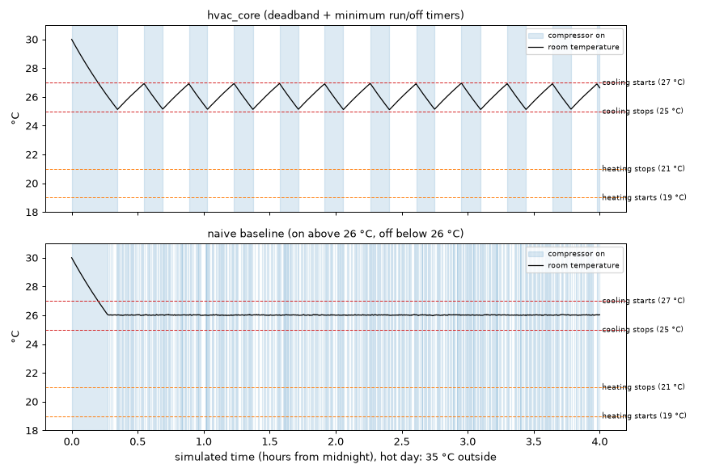

# Phase 5: Thermostat control core and simulation

## 1. What this phase adds

The thermostat's "brain": a small, pure C state machine (`hvac_core`) that decides when to cool, heat
or raise an alarm. It also adds a configuration-file parser, 52 unit tests (run three ways, plus
coverage), and a 24-hour room simulator. The simulator shows the core keeps a room comfortable without
wearing out the compressor.

## 2. Why it matters

A compressor that switches on and off every few seconds ("short-cycling") wears out quickly and wastes
energy. Manufacturers protect it with **minimum run** and **minimum off** times, and with
**hysteresis** (a deadband). Testing those rules on real equipment takes days. Simulation takes 40 ms.

## 3. Files added or changed

| File | Purpose |
| --- | --- |
| `thermostat/include/hvac_core.h`, `src/hvac_core.c` | The pure state machine (section 4.4) |
| `thermostat/include/config.h`, `src/config.c` | `key = value` configuration parser (section 4.5) |
| `thermostat/tests/test_hvac_core.c` | 34 tests: every transition, boundary, timer, fault rule |
| `thermostat/tests/test_config.c` | 18 tests: valid files, errors with line numbers, file loading |
| `thermostat/sim/room_model.c` | Room heat model + simulated sensor (integer micro-degrees) |
| `thermostat/sim/baseline_controller.c` | Naive on/off thermostat for comparison |
| `thermostat/sim/sil_metrics.c`, `sil_main.c` | Metrics and the simulator program |
| `thermostat/third_party/unity/` | Vendored Unity v2.7.0 test framework |
| `thermostat/CMakeLists.txt` | Build with strict warnings; options `HVAC_SANITIZE`, `HVAC_COVERAGE` |
| `scripts/test_host.sh` | lint, cppcheck, unit tests x3, coverage, simulation |
| `scripts/check_coverage.py`, `check_sil.py`, `plot_sil.py`, `host_summary.py` | Checks, plot, totals |

## 4. How it works

```
             temp >= cool_sp + deadband (27 C) AND off for >= 180 s (or never run)
      +----------------------------------------------------------------+
      |                                                                v
   +------+   temp <= heat_sp - deadband (19 C)   +---------+      +---------+
   | IDLE |-------------------------------------->| HEATING |      | COOLING |
   +------+<--------------------------------------+---------+      +---------+
      ^      temp >= heat_sp + deadband (21 C)                         |
      +----------------------------------------------------------------+
             temp <= cool_sp - deadband (25 C) AND running for >= 120 s

   any state --(invalid reading: read error, out of range, or jump > 5 C)--> FAULT
   FAULT --(5 valid readings in a row)--> IDLE
```

1. **Pure function.** `hvac_core_step(ctx, input, outputs)` gets the temperature and the current time
   as arguments. It never reads a clock or a file and never allocates. So a test can say "it is now
   t = 179999 ms" and check that the compressor is still blocked, without waiting three minutes.
2. **Hysteresis.** Cooling starts at 27 °C but stops only at 25 °C. Without the gap, noise around one
   threshold would flip the compressor every second.
3. **Timers.** Minimum run (120 s) and minimum off (180 s) protect the compressor. The very first start
   is allowed immediately.
4. **FAULT.** A reading that is missing, outside -40..125 °C, or jumps by more than 5 °C since the last
   good one is not believed. Everything turns off and the alarm turns on. Recovery needs 5 good readings
   in a row.
5. **Simulation (software in the loop, SIL).** A room model leaks heat towards the outside temperature
   (time constant about 1 hour) and gains heat from the sun and from people. The compressor removes
   6 m°C/s and the heater adds 6 m°C/s. A simulated sensor adds noise and rounds to 1/16 °C like the
   real chip. The *real* `hvac_core` runs against it for 24 simulated hours.

## 5. Run it yourself

```
make test-host                          # about 1 minute
cat results/host/coverage.json          # per-file line and branch coverage
build/thermostat/sil results/sil        # 6 runs, prints one JSON line each
```



Reading the plot: the top panel is `hvac_core`. The room swings slowly between the cooling start and
stop lines (25 and 27 °C), with a short burst of cooling roughly every 20 minutes. The bottom panel is
the naive baseline. It holds 26 °C, but the compressor flickers on and off every few seconds. The
shading looks almost solid because there are hundreds of starts per hour.

## 6. Tests and results

Gate `make test-all` on 2026-11-15: host **52 unit tests passed** (normal, ASan+UBSan, Valgrind), guest
90/90, 0 skipped.

| Check | Result | Target |
| --- | --- | --- |
| Unit tests (normal / sanitizers / Valgrind) | 52 / 52 / 52 passed | all |
| Sanitizer reports, Valgrind errors, leaked bytes | 0, 0, 0 | 0 |
| cppcheck findings | 0 | 0 |
| `hvac_core.c` coverage | 100 % lines, 98.9 % branches | >= 95 / >= 90 |
| `config.c` coverage | 98.1 % lines | >= 90 |

Simulation, 24 h each, seed 1:

| Scenario | Controller | Comfort % | Time to comfort (min) | Starts/hour | Short cycles | Min off gap (s) | Duty % |
| --- | --- | --- | --- | --- | --- | --- | --- |
| hot_day | **product** | 100.00 | 9.8 | **2.83** | **0** | 418 | 52.13 |
| hot_day | baseline | 100.00 | 9.8 | 592.20 | 14212 | 1 | 52.03 |
| cold_day | **product** | 100.00 | 20.4 | 0.00 | 0 | - | 0.00 |
| cold_day | baseline | 100.00 | 20.4 | 0.00 | 0 | - | 0.00 |
| mild_day | **product** | 100.00 | 0.0 | **0.50** | **0** | 1489 | 5.05 |
| mild_day | baseline | 100.00 | 0.0 | 113.50 | 2720 | 1 | 5.46 |

Interpretation: both controllers keep the room comfortable, but the baseline starts the compressor
about **200 times more often** on the hot day. Almost every one of those starts violates the 3-minute
rest the compressor needs. The product core uses about the same energy (duty cycle) with 68 starts a
day instead of 14,213.

## 7. Key concepts

- **State machine.** A system that is always in exactly one named state and moves between states by
  explicit rules. It is easy to draw, test and explain.
- **Fake time.** Time is an input, so tests jump to any moment instantly. This is why the core reads no
  clock.
- **Sanitizers and Valgrind.** AddressSanitizer and UndefinedBehaviorSanitizer add checks at compile
  time, and Valgrind checks the unmodified program at run time. They catch out-of-bounds accesses, leaks
  and undefined behaviour (for example signed overflow).
- **Coverage.** Which lines and branches the tests executed. 100 % does not prove correctness, but
  untested code is unknown code.
- **SIL (software in the loop).** Real control code against a simulated plant. It is the standard first
  step before hardware-in-the-loop testing.

## 8. What could go wrong

- Floating point in the simulator would make results machine-dependent. Everything is integer (D-023).
- A test that sleeps would make the suite slow and flaky. All timing uses fake time.
- `-Wconversion` forces every narrowing cast to be explicit, so silent truncation cannot hide.
- Known core limitation: if the sensor is gone while the room changes more than 5 °C, the core stays in
  FAULT until restarted. This is safe, but noted in D-021.

## 9. Interview questions

1. *What is short-cycling and how does the code prevent it?* Rapid compressor on/off. Prevented by the
   deadband (2 °C between start and stop) and the minimum run/off timers. The simulator counted 0
   violations versus 14,212 for a naive controller.
2. *Why keep the control core pure?* It can be tested exhaustively with fake time, it gives the same
   answer on every machine, and it ports to an RTOS (real-time operating system) unchanged (Ext 4).
3. *How do you test a 3-minute timer without waiting 3 minutes?* Pass time in as an input and test
   179,999 ms and 180,000 ms directly.
4. *What does 98.9 % branch coverage mean?* Of all `if` outcomes in `hvac_core.c`, 98.9 % were taken by
   some test.
5. *What is hysteresis?* Different thresholds for switching on and off, so noise near one threshold
   cannot make the output flicker.
